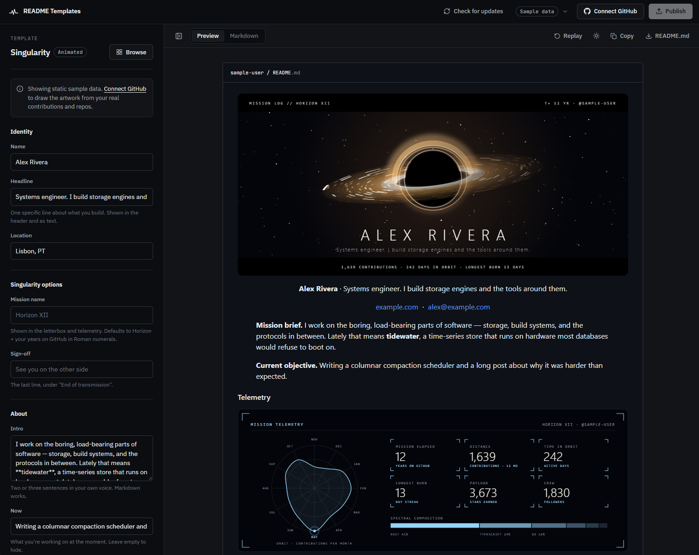
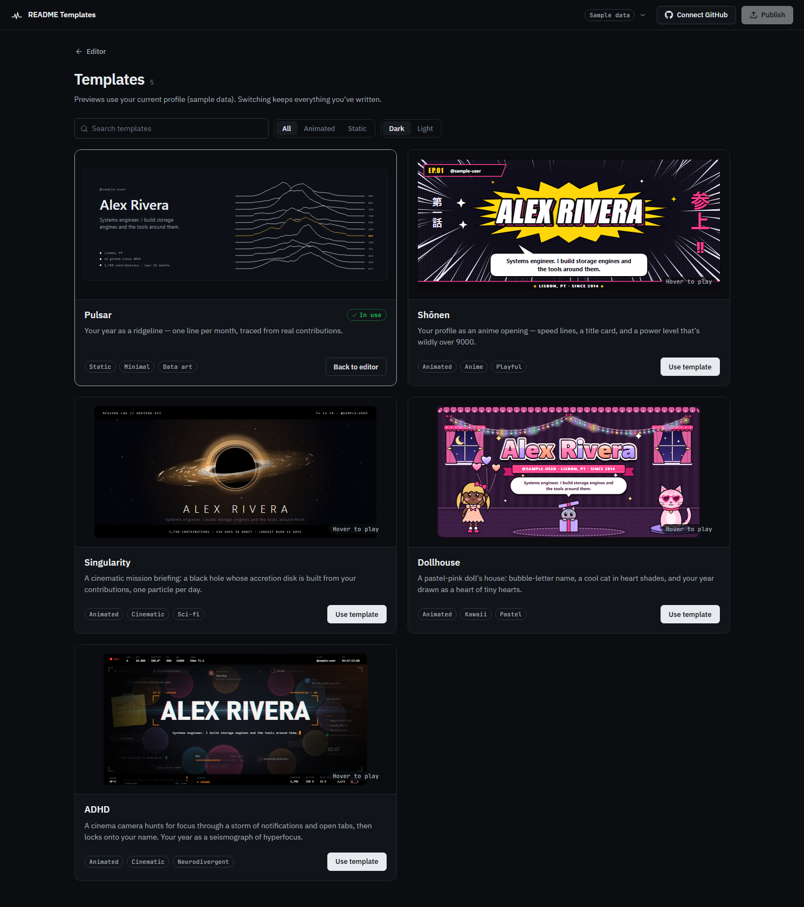
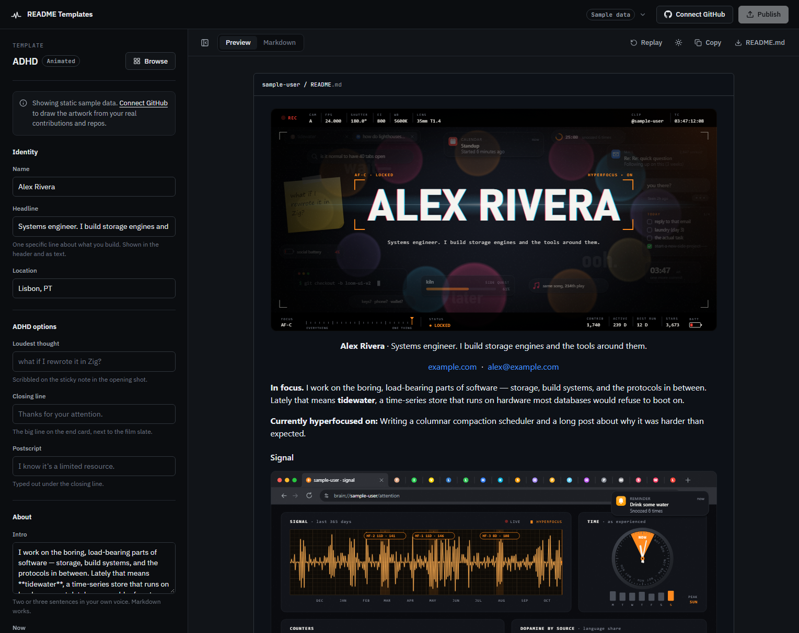
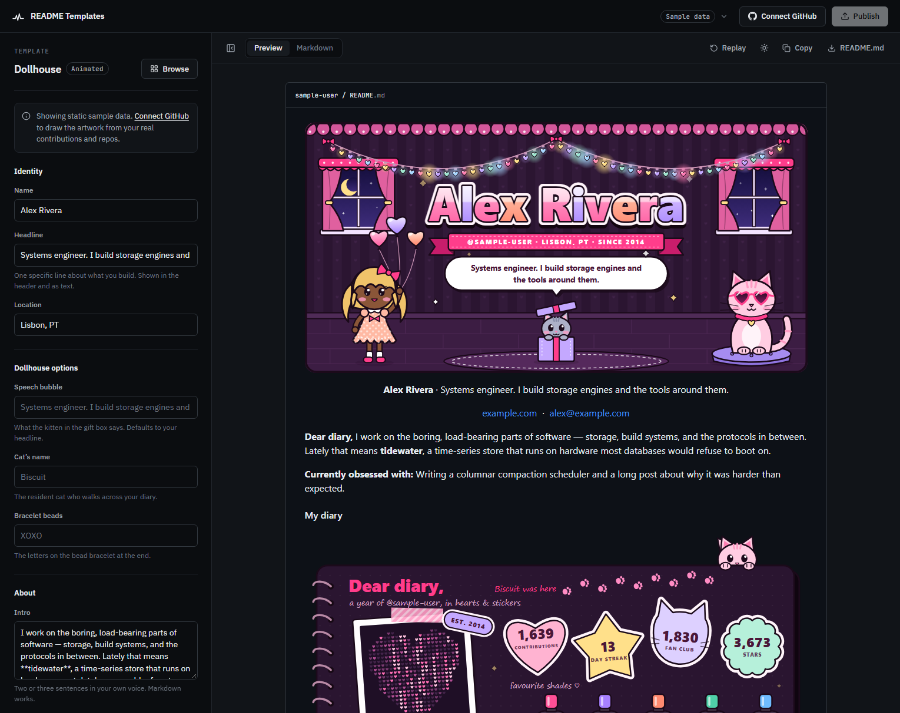
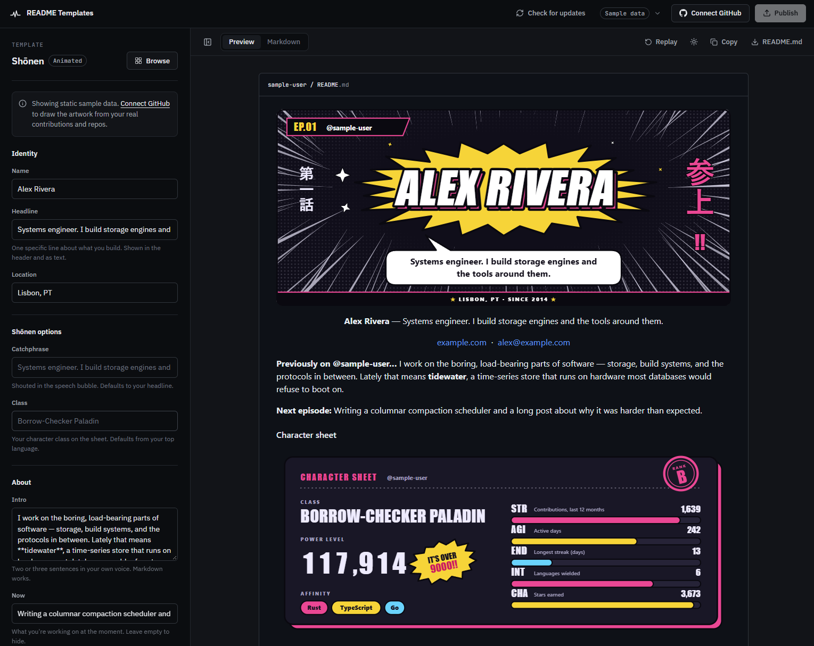
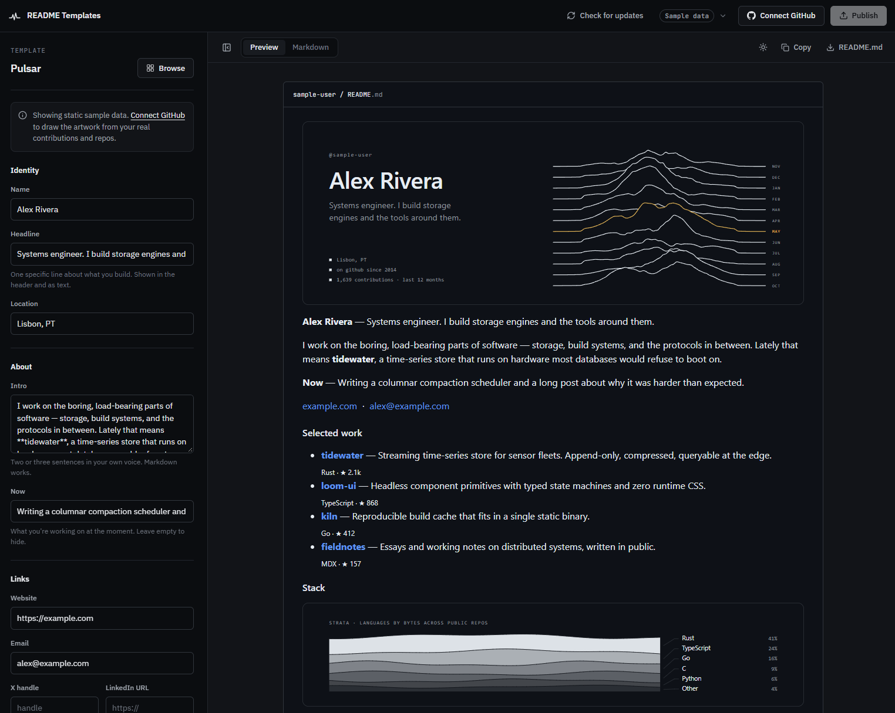

# README Templates

**Design a GitHub profile README that stands out, then publish it to your profile in one click.**

[](LICENSE)
[](https://github.com/Dr-At0mic/README-Templates/releases/latest)


<p align="center">
  
</p>

A desktop app for Windows and Linux (or a web app you run yourself). Pick a template, and it draws original artwork from your real GitHub activity. Tweak the text, see exactly how GitHub will show it in dark and light mode, and publish straight to your profile.

**[⬇ Download the latest release](https://github.com/Dr-At0mic/README-Templates/releases/latest)**

---

## More than a template gallery

Most README generators hand you a block of markdown, and the rest is your job: create the special `username/username` repo, upload the images, paste and commit. Then do it all again for every account. README Templates does the whole job.

- **It publishes for you.** Connect your account and press **Publish**. The app creates or updates your profile repo with the README and all its artwork in a single commit, and tells you exactly what will change first. No copy-paste, no git.
- **Multiple accounts, no juggling.** Got a personal account and a work account, or a few more? Add them all and switch with one click.
  - Each account keeps its own key and its own edits.
  - **Publish** always goes to the account you're on, so you never post to the wrong profile.
  - No more signing out of GitHub, digging up tokens again, or redoing your edits.
- **Artwork from your real data.** Contributions, active days, streaks, languages and stars become the art itself. No third-party stats widgets that rate-limit or disappear: every image is a plain SVG committed to your own repo.
- **What you see is what GitHub shows.** The live preview renders the README the way GitHub does, in both dark and light themes.
- **The app keeps itself up to date.** It checks for new versions at launch, so new templates and fixes arrive with one click: **Check for updates → Install and restart**.
- **Try it without signing in.** With no account connected, it runs on built-in sample data and makes no network requests at all.

## Your token stays with you

You don't hand your GitHub access to anyone. There's **no server, no sign-up and no analytics**: the app runs entirely on your own computer.

- **Direct to GitHub:** your token only ever goes from your machine to GitHub's own API (`api.github.com`), never to us or any third party. The desktop app is locked down to make sure of it: it can't contact any other address.
- **Your choice of storage:** for each account, save it on this device (encrypted with AES-256-GCM, using a device key the app can't export), keep it for this session only, or remove it. **Clear all saved keys** wipes everything at once.
- **Public data only:** the app reads only your public, non-fork repositories, so private repo names never end up in a public README.
- **Open source:** every line is in this repo, so you can check it yourself.

<details>
<summary>Technical details: how tokens are stored</summary>

- Tokens are encrypted with **AES-256-GCM**.
- The key is derived (HKDF-SHA-256) from a random per-device key, which IndexedDB holds as a **non-extractable** WebCrypto key, together with `VITE_VAULT_SECRET`.
- Each record is bound to its login, so records can't be swapped between accounts. Decrypted tokens only ever live in memory.
- Copying the app's storage files alone yields nothing usable.
- `VITE_VAULT_SECRET` is compiled into the app, so it isn't confidential. It works as a rotation lever: change it, and every saved token becomes unreadable.
- As with any app that runs web code, this can't protect against malicious script injected into the app itself. The desktop app's strict content security policy is there to prevent that.

</details>

## Templates

> **There are 5 templates for now, and more are coming soon.** Thanks to the built-in updater, new ones show up in the desktop app automatically. Have an idea for a style? [Open an issue](https://github.com/Dr-At0mic/README-Templates/issues) or [build one yourself](CONTRIBUTING.md#add-a-new-template).

<p align="center">
  
</p>

### ADHD · animated, cinematic

A cinema camera's monitor feed, trying to focus on you.
- **The opening shot:** autofocus hunts through a storm of interruptions (notifications, open tabs, a sticky note, a to-do list whose only finished item is "start a new side project"), then locks onto your name. The RGB split converges, an anamorphic flare fires, and everything else recedes. The out-of-focus lights behind it are your year, one per month.
- **Signal:** a browser with far too many tabs open, your projects among the rabbit holes. Inside: your last 365 days as a seismograph with your hyperfocus episodes marked, a clock with only two times on it (now, and not now), odometer counters, and your languages as dopamine sources.
- **The end card:** a film slate snaps shut. *Thanks for your attention. I know it's a limited resource.* You can write the loudest thought on the sticky note, and the closing lines.

<p align="center">
  
</p>

### Dollhouse · animated, kawaii

A pastel-pink doll's house where your profile lives.
- **The room:** your name drops in as glossy bubble letters, a doll floats down on heart balloons, a cool cat gets heart-shaped shades, and a kitten bursts out of a gift box wearing the lid. The fairy lights are your year: one heart bulb per week, brighter for busier weeks.
- **Dear diary:** your last year as a heart made of tiny hearts (one per day), your stats as die-cut stickers, and your top languages as nail-polish bottles.
- **Yours alone:** the doll and the cats are drawn from your username. You can name the cat, and choose the letters on the bead bracelet that signs off the page.

<p align="center">
  
</p>

### Singularity · animated, cinematic sci-fi

A mission briefing with a black hole at its centre.
- **Hero:** the accretion disk is built from your contributions, one particle per day; busier days glow brighter and orbit closer.
- **Mission telemetry:** your year as an orbit trajectory, with readouts for years on GitHub, contributions, active days, streak, stars and followers.
- **Light theme:** printed as a photographic negative, the way astronomical sky surveys were.

*(Screenshot at the top of this page.)*

### Shōnen · animated, playful

Your profile as an anime opening.
- **Title card:** speed lines, an impact burst, and your name slamming in.
- **RPG character sheet:** built from your real stats (STR = contributions, AGI = active days, END = streak, INT = languages, CHA = stars), plus a class taken from your top language and a gloriously meaningless power level.

<p align="center">
  
</p>

### Pulsar · static, minimal

Your year as a ridgeline: twelve stacked lines, one per month, traced from your daily contributions, in the manner of the famous PSR B1919+21 pulsar plot. Your busiest month is drawn in amber, and your languages appear as geological strata.

<p align="center">
  
</p>

**Every template:**
- uses original artwork, generated for you;
- ships dark and light versions that follow the viewer's GitHub theme;
- has real alt text, and keeps your name, bio and projects as plain text for search engines and screen readers;
- animates with pure CSS inside the SVG (no GIFs, no scripts), and respects *reduce motion* by showing the finished frame.

## Download

Grab the latest build from **[Releases](https://github.com/Dr-At0mic/README-Templates/releases/latest)**:

| System | File | Install |
|---|---|---|
| Windows 10 / 11 | `README.Templates_x.y.z_x64-setup.exe` | Run it. Installs for your user only, no admin needed. |
| Windows (managed) | `README.Templates_x.y.z_x64_en-US.msi` | For company / Intune deployment |
| Ubuntu, Debian, Mint | `README.Templates_x.y.z_amd64.deb` | `sudo apt install ./README.Templates_*_amd64.deb` |
| Fedora, RHEL, openSUSE | `README.Templates-x.y.z-1.x86_64.rpm` | `sudo dnf install ./README.Templates-*.x86_64.rpm` |
| Any Linux distro | `README.Templates_x.y.z_amd64.AppImage` | `chmod +x README.Templates_*.AppImage`, then run it |

- **Windows SmartScreen:** the builds aren't code-signed yet, so Windows may say *"Windows protected your PC"*. Click **More info → Run anyway**.
- **Linux requirements:** a 64-bit distro with glibc 2.35 or newer, such as Ubuntu 22.04+, Debian 12+, Fedora 36+ or Mint 21+. The `.deb` and `.rpm` add **README Templates** to your app menu and a `readme-templates` command. The AppImage may need FUSE: `sudo apt install libfuse2t64`, or `libfuse2` on Ubuntu 22.04.
- **Linux blank or white window** (common in VMs): start the app with `WEBKIT_DISABLE_DMABUF_RENDERER=1 readme-templates`.

### Updates

The **Check for updates** button sits in the top bar.
- It checks quietly at launch, and changes to **Update available** when there's a new version.
- One click shows what's new, downloads the update, verifies it against the project's signing key (so a tampered file is refused), installs it and restarts the app.
- Your saved accounts and edits are kept.
- On Linux, updating a `.deb` or `.rpm` install asks for your password. The AppImage updates itself in place.

## How it works

1. **Pick a template** on the Templates page. It starts on sample data, so you can explore freely.
2. **Connect GitHub** (top right) with a personal access token, and the artwork redraws from your real profile in one query. Add more accounts the same way.
3. **Edit** your headline, intro, links and template options; the preview updates as you type.
4. **Publish.** The app checks your `username/username` repo and says whether it will create the repo, add a README or replace the existing one, then commits `README.md` and the artwork in one go. Prefer to do it by hand? **Copy** the markdown or download the files instead.

**Token:** a classic token with `public_repo` + `read:user`, or a fine-grained token with *Contents* and *Administration* write access to your profile repo. The Connect dialog links straight to GitHub's token page.

## Run it from source

You need [Node.js](https://nodejs.org) 20 or newer.

```bash
git clone https://github.com/Dr-At0mic/README-Templates.git   # or your fork
cd README-Templates
npm install
cp .env.example .env    # then set VITE_VAULT_SECRET (the file explains how to generate one)
npm run dev             # http://localhost:5173
```

`npm run build` writes a static site to `dist/`. You can host it anywhere: GitHub Pages, Netlify, or any static server.

### Build the desktop app

The desktop app uses [Tauri v2](https://tauri.app), which runs on the system's own web engine (WebView2 on Windows, WebKitGTK on Linux), so installers are only a few MB. Install the [Tauri prerequisites](https://tauri.app/start/prerequisites/) for your OS first: Rust, plus the Visual Studio C++ build tools on Windows or the WebKitGTK dev packages on Linux.

```bash
npm run desktop:dev           # desktop window over the dev server (stop `npm run dev` first: both use port 5173)
npm run desktop:build         # installers for the OS you're on, in src-tauri/target/release/bundle/
npm run desktop:build:linux   # on Windows: build the Linux packages inside WSL Ubuntu
```

<details>
<summary>Linux packages from Windows (WSL)</summary>

`npm run desktop:build:linux` runs [scripts/build-linux.sh](scripts/build-linux.sh) inside WSL Ubuntu:
1. It mirrors the source to `~/.cache/readme-templates-linux`.
2. It builds there.
3. It copies the `.deb`, `.rpm` and `.AppImage` to `src-tauri/target/linux/`.

One-time setup inside WSL:

```bash
# as root (from Windows: wsl -d Ubuntu -u root)
apt-get install -y libwebkit2gtk-4.1-dev build-essential curl wget file libxdo-dev libssl-dev \
  libayatana-appindicator3-dev librsvg2-dev xdg-utils rsync
curl -fsSL https://deb.nodesource.com/setup_22.x | bash - && apt-get install -y nodejs
# as your user
curl --proto '=https' --tlsv1.2 -sSf https://sh.rustup.rs | sh -s -- -y
```

A local Linux build only runs on distros with the same glibc as the machine that built it, or newer. Official releases are built on Ubuntu 22.04.

</details>

<details>
<summary>How the desktop app differs from the web version</summary>

- **Links** open in your default browser, so the studio window never navigates away.
- **Downloads** use the native Save dialog.
- **Accounts** are stored separately from your browser's: in `%LOCALAPPDATA%\com.readmetemplates.studio` on Windows and `~/.local/share/com.readmetemplates.studio` on Linux.
- **Locked down:**
  - The Content Security Policy allows only the app itself and `api.github.com`.
  - The app can't read files at all. It can only write to a file you just picked in the Save dialog.

</details>

## Releasing

Releases are built by GitHub Actions ([.github/workflows/release.yml](.github/workflows/release.yml)). The workflow builds the Windows and Linux packages, signs the update files, and publishes a GitHub release with the `latest.json` the update button reads.

```bash
# 1. bump "version" in package.json (the desktop app reads it from there)
# 2. commit, then tag and push:
git tag v2.1.0
git push origin v2.1.0
```

The workflow needs these repository secrets (**Settings → Secrets and variables → Actions**):

| Secret | Value |
|---|---|
| `TAURI_SIGNING_PRIVATE_KEY` | Contents of the updater private key |
| `TAURI_SIGNING_PRIVATE_KEY_PASSWORD` | Its password |
| `VITE_VAULT_SECRET` | Any random string. Keep it the same across releases, or saved accounts stop decrypting after an update. |

**Publishing your own builds from a fork?** Generate your own key pair with `npx tauri signer generate -w ~/.tauri/readme-templates.key`. Then, in [src-tauri/tauri.conf.json](src-tauri/tauri.conf.json), replace `plugins.updater.pubkey` with your public key, and point `endpoints` at your repo's releases. Otherwise your builds will look for updates from this repo. Never commit the private key; `*.key` is gitignored.

## Contributing

Contributions are welcome: bug reports, ideas, fixes, docs, and especially new templates. Read **[CONTRIBUTING.md](CONTRIBUTING.md)** for setup, the project layout, how to add a template, the template rules, and the pull request checklist.

Found a security problem? Please report it privately (see [Security issues](CONTRIBUTING.md#security-issues)) instead of opening a public issue.

## License

[MIT](LICENSE) © 2026 Anandhu Suresh. You're free to use, fork, modify and redistribute it. The artwork the app generates from your profile is yours.
